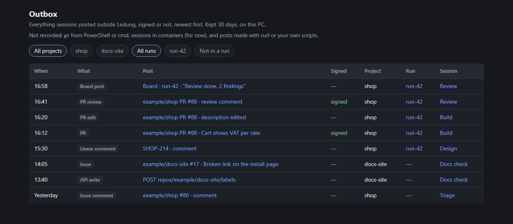

# A project signature, with a living PR summary — proposal

Nov 26, 2026, revised Nov 27 (Ledung's signature replaces Claude Code's line) · Proposal for issue #513 (run-179). Not approved yet; nothing is built.

**Done when:** the seven "Done looks like" points of #513 hold: a signature per project with a switch per place; `gh` issue/PR create, comment and review get it from every body source on Windows and Mac; every other `gh` call is unchanged; another server's write tool gets it after one question per tool and project; a run's PR carries a summary that follows the run; an Outbox lists what went out; and never a second signature, one on a read-only call, a private detail in one, or a broken `gh`.

## Why

Sessions write issues, comments, PRs and commits on GitHub and other trackers in the person's name. People reading them can't tell that the work came through Ledung, or which run it belongs to. Simon talked it through on 2026-11-26 and liked the direction: one short, factual line per project that the project can change or turn off, and a hidden marker that lets Ledung find its own posts again (no double signatures, a PR summary that follows the run, a list of what went out).

The signature is a **courtesy line, not proof**. A session can always reach the real `gh` or the site; nothing here is a security boundary, so it never blocks work.

## The two checks (done 2026-11-26)

1. **Can a hook change another MCP server's tool call? Yes.** A throwaway stdio MCP server (`tracker`, tool `create_comment`) ran under the Agent SDK 0.3.295 / Claude Code 2.1.319 with Haiku. A `PreToolUse` hook returning only `hookSpecificOutput.updatedInput` (no `permissionDecision`) changed the body. The server received `"hello\n\n— via Ledung"`. Importantly, **the permission check still ran**: `canUseTool` was called with the signed input, so the person approves the text that will actually go out. With the tool in `allowedTools`, it went through signed without a prompt, as before. The hook input also names the server (`mcp_server: {name, source}`).
2. **Does a stand-in `gh` work on Windows? Yes, as a shell script and a `.ps1`, not as a `.cmd`.** A folder with the stand-in put ahead of the real `gh` on `PATH`:
   - **Git Bash** (Claude Code's Bash tool on Windows; also macOS, Linux): an extensionless `gh` shell script (`exec node gh.mjs "$@"`) is found first. Arguments arrive exactly (`50% & <done> "q" !x ^y $HOME`), stdin passes through (`--body-file -`), and the real `gh`'s output and exit codes (0, 1) come back unchanged.
   - **PowerShell 5.1**: a `gh.ps1` is picked before the real `gh.exe`. It passes stdin only when written to forward `$input`; the first version hung on a pipe. Embedded `"` are lost, but that is PowerShell 5.1's own native-argument behaviour and happens with the real `gh.exe` too. **Risk:** Windows' default execution policy (`Restricted`) refuses a `.ps1`, which would turn `gh` into an error (point 7). See open choice 3.
   - **cmd**: a `gh.cmd` can't pass arguments safely. cmd re-reads `%`, `&`, `^` and `!` in `%*`, and in the test the body arrived split into pieces. So there is no `.cmd`. cmd skips the extensionless script and finds the real `gh.exe`: unsigned, but intact.
   - **Signing and falling back** (a prototype `gh.mjs`, Git Bash): a body from `--body-file <file>`, from `-F -` (stdin) and from `--body` came out signed as `<body>\n\n— via Ledung for Simon\n<!-- ledung run-0 -->`. A body that already had the marker was passed on unchanged. With the session file missing, or a simulated bug in the stand-in, the real `gh` ran with the original arguments. `gh --version` gave the same output and exit 0, and a failing `gh issue comment … --repo <nonexistent>` gave the same error and exit 1 as the real `gh` called directly. Two things the prototype showed that the real one must do: when falling back, say nothing on stderr (the prototype printed a line, which changes the output; the reason goes to the journal instead), and keep stdin it has already read so it can be handed to the real `gh`.
   - **Mac, reasoned only:** the shell-script stand-in is the Git Bash case. zsh and bash look up `PATH` in order, `exec` keeps the exit code, and Node is there because Ledung runs on it. The only difference is the real `gh`'s path (`/opt/homebrew/bin/gh` or `/usr/local/bin/gh`), which Ledung finds when the session starts. Points 2 and 3 on Mac still need one run on a Mac in part 1.

## What it does

### The signature, per project

In the project's settings, a **Signature** section:

- **Text**, prefilled with Ledung's default `— via Ledung for {user}`. Fill-ins: `{user}` (Ledung's user name), `{project}` (the project's name), `{run}` (`run-179`), `{workflow}` (the flow's name), `{steps}` (the run's steps so far, by block title, with ✓ or "skipped"). Outside a run, the run fill-ins are empty and a line left empty by them is dropped.
- **Switches** for where it goes: new issues · issue comments · PR descriptions · PR comments and reviews · commits · other trackers. With all off, nothing is added anywhere, not even the marker (point 1).
- **Defaults, as the manager suggested:** on for **PR descriptions and new issues in public repos**, and off everywhere else: private repos, comments and reviews, commits, and other trackers (which are mostly work tools). Ledung reads a repo's visibility once (`gh repo view --json visibility`, through the session's runner) and keeps it. If the visibility can't be read, the repo counts as private. A project can switch any place on or off by hand, which overrides the default.
- **Ledung's signature replaces Claude's line** (Simon, 2026-11-27, question #2434: "We should override Claude Code's signature."). Where the PR-descriptions switch is on, Claude Code's "🤖 Generated with Claude Code" line (its `attribution.pr` setting) is replaced by the project's signature, so a PR carries one line, Ledung's. See "Claude Code's lines" below for how, for commits (open choice 6) and for a switch that is off (open choice 7).
- **Where the settings live: the project's settings, not the workflow.** Whether and how a project signs is about the repo and who reads it, and it applies to work outside a run too. A workflow only adds what it knows, through the fill-ins `{run}`, `{workflow}` and `{steps}`, and the PR summary. Saved like the other project settings, in the project's part of the config, so a work project's text can stay in `ledung.config.local.json`. Changing it affects new posts only.

Only these fill-ins exist. Session titles, folder paths, account names and anything else private can't be put in a signature, because there is no fill-in for them (point 7). The text is checked against the project's sensitive patterns on save, as board posts are.

### The marker

Every signed body ends with the signature, then a hidden marker where the site renders Markdown: `<!-- ledung run-179 -->`, or `<!-- ledung -->` outside a run. Before signing, the body is searched for `<!-- ledung`. If it is there, nothing is added. That covers a repeated post, a body copied from an earlier one, and a session that signed by hand. Edits (`gh issue edit`, `gh pr edit`, `gh api … PATCH`) are never signed (point 7). **When a tracker strips the marker (Linear, Jira and others):** Ledung never relies on the marker coming back. Two other checks keep point 7:

- **The text check:** a body that already ends with the project's filled-in signature, or contains `via Ledung`, is left alone. That covers a session copying an earlier post.
- **Ledung's own record:** each signed call is journalled (tool, the target's id, such as the issue key, and a hash of the body). The same tool, target and body within a day is a repeat and is not signed again.

Edits there are update tools, which are not signed unless the person picks a field for them, and a body that already carries the signature is left alone. What is lost without a marker is only finding the post again from the tracker's side. The Outbox still lists it, from the journal. The living summary is a GitHub-only thing. For trackers whose Markdown keeps HTML comments, the marker is added as on GitHub. Whether one does is found out in part 2, per tracker, not assumed.

### GitHub: the stand-in `gh`

Ledung writes a small stand-in into its data folder (`<data>/gh-stand-in/`, via `src/platform/paths.ts`). It is a `gh` shell script and, if chosen, a `gh.ps1`, both calling one `gh.mjs` run by Ledung's own Node. Ledung puts that folder first on the session's `PATH` in `sessionEnv`. A per-session file next to it holds the real `gh`'s full path (found when the session starts), the signature already filled in, the switches, and the run. No `LEDUNG_*` variable is used, so the rule "sessions don't inherit LEDUNG_* settings" stays as it is.

`gh.mjs` reads its arguments, not a command line:

- It signs only `issue create`, `issue comment`, `pr create`, `pr comment` and `pr review` (with `--comment`, `--approve` or `--request-changes` and a body), and only when that place's switch is on.
- It takes the body from `--body`/`-b`, `--body-file`/`-F` (a file, or `-` for stdin), and writes the signed body to a temporary file passed as `--body-file`. Stdin is read only when the call itself reads it.
- A call with no body of its own (`--fill`, `--web`, `--editor`, interactive) is passed through unchanged. The PR summary fills that gap for PRs.
- Every other call `exec`s the real `gh` with the same arguments, stdin, stdout and exit code (point 3).
- **Any failure in the stand-in** (missing or unreadable session file, a bug, an argument it can't parse) runs the real `gh` with the original arguments, untouched (point 7). Only the real `gh`'s own failures are reported as failures.
- After a signed call, it appends one line to the session's journal: kind, repo, the URL that `gh` printed, the time. That journal feeds the Outbox. A fallback writes its reason there too, never to stderr.

Container sessions run `gh` inside the container, which Ledung doesn't write to today. See open choice 2.

### Other trackers: one question per tool, then a hook

Ledung's existing `PreToolUse` hook gets one more step for `mcp__*` tools of servers that aren't Ledung's own:

- **Which tools count as writes:** those not marked `readOnly` in the server's own tool list (`mcpServerStatus()`, which gives name, description and annotations, but no input schema), whose name or description says create, add, post, comment, reply or update, and whose call has at least one string field.
- **The first call** of such a tool in a project goes through **unsigned**. The project's settings get a waiting item, with a small badge on the project: "Linear: create_comment. Which field gets the signature?", offering the call's string fields (`body`, `title`, …) and "None". The answer is kept per project and tool. Every later call has the signature added to that field as the call passes (the check-1 mechanism), and the server's own sign-in is untouched (point 4). See open choice 1 for asking during the call instead.
- **Fitting into the hook chain:** the signed input is worked out first. Every `allow` the chain returns afterwards (grants, rules, away mode) carries it as `updatedInput`, and an "ask" carries it too, so the person approves the signed text. A refusal stays a refusal. Never adding a signature to a call that Ledung or the person would refuse keeps point 7.
- A `PostToolUse` step writes the same journal line, with any URL found in the result.

### Claude Code's lines

Claude Code adds its own attribution from two settings: `attribution.pr` (the "🤖 Generated with Claude Code" line at the end of a PR description) and `attribution.commit` (the `Co-Authored-By: Claude …` trailer). Claude writes both itself, as text it is told to add, so a stand-in can't take them out reliably afterwards. Ledung sets them instead, per session, through the SDK's `settings` option, which ranks above the person's own Claude Code settings for that session only. Their own settings file is never changed, and sessions outside Ledung keep Claude's lines.

**PR descriptions, switch on:**

- **Outside a run:** `attribution.pr` is set to the project's filled-in signature with its marker (`— via Ledung for Simon` and `<!-- ledung -->`). Claude then ends a PR description with Ledung's line in place of its own, also where the stand-in doesn't reach (PowerShell, a container). Where the stand-in does reach, it finds the marker and adds nothing, so there is still one line.
- **In a run:** `attribution.pr` is set to empty, which Claude Code reads as "no line". The run's PR gets its signature from the living summary (below), so a PR made in a run carries one signature, inside the summary.
- The switch follows the project's repo (its visibility, read once). A PR into another repo gets the stand-in's own check of that repo; the session-wide setting can't vary per repo, which is acceptable for a courtesy line.

**PR descriptions, switch off:** Ledung leaves `attribution.pr` alone, so Claude's line comes back as the person's settings have it (open choice 7). With the default places, that is what private repos get.

**Commits:** what happens to the `Co-Authored-By` trailer is open choice 6. Whatever is chosen, a session in a run with the commits switch on also gets `Ledung-Run: run-179` added through `attribution.commit`. Outside a run, or with the switch off, commits are as Claude Code makes them. No git hooks are installed in anyone's repository.

Not checked yet, so done in part 3 before anything else: that the SDK's `settings` option really wins over a user's own `attribution` for that session, and that an empty `attribution.pr` gives no line rather than Claude's default.

### The living PR summary

For a run whose branch has a PR (Ledung already finds it through `pr-poll.ts`), Ledung keeps one section at the end of the PR description, between `<!-- ledung run-179 summary -->` and `<!-- /ledung -->`:

```
---
**Ledung run-179** · Developing Ledung
✓ Issue + Done looks like · ✓ Design · ✓ Build · – Test (skipped) · ✓ Review · ✓ Approved by Simon
— via Ledung for Simon
```

- It is built only from the run's record: the step history, block titles and outcome words, and who reported each step ("Approved by Simon" comes from a person block's answer). A step the run went past without running shows "skipped" (point 5).
- **Who updates it: Ledung itself, not a session.** No session spends turns or plan use on it, and it can't be forgotten. When a step is reported (`flow_step`, or a person's answer at a person block), the run code queues an update for the run's PR. If there is no PR yet, the update happens when the PR poll first finds one for the run's branch. The update goes through the project's runner, as the PR poll does, so it uses the project's own `gh` sign-in (the container's, for a container project): `gh api` GET the body, replace only what lies between the markers (or append the section if there is none yet), PATCH.
- At most one update a minute per PR (step reports that come close together are merged), charged to the GitHub budget like the PR poll. Text outside the markers is never touched, so a hand edit stays. If someone removed the markers, Ledung stops updating that PR and says so on the run. A PR that is merged or closed gets one last update when the run ends, then no more.
- The PR's own signature is folded into the summary, so a PR made in a run carries one signature, not two, and no Claude line (`attribution.pr` is empty in a run). The stand-in sees the run in its session file and leaves the body to the summary.
- It is governed by the PR-descriptions switch.

### The Outbox

A list of everything sessions posted outside, newest first: when, the kind (issue, comment, PR, review, PR summary, a tracker's comment), a link to the post, the project, the run (a link to it), and the session (a link to it; session titles are shown only here, inside Ledung, never in a signature). It can be filtered by project and run, or "Not in a run". It is built from the journals and the hook's record, kept in the database (a new `MIGRATIONS` entry) for the evidence period, then trimmed. At 1280 px it is a table. At 390 px each entry is a card of two lines: the kind and the link, cut off with "…", then project · run · time · session. Where it lives is open choice 5. The board's held posts are also called an outbox in the code (PR #131), but the page never shows that word, so the name is free.

Mock-up (static, dark mode, made-up projects; `project-signature/outbox-mock.html`):




## What is shown

- **Project settings → Signature:** the text field with a live preview filled in for a sample run, six switches, and the list of tracker tools with their chosen field (changeable, or "None").
- **A waiting badge** on the project when a tracker tool's field is still unchosen.
- **The run page:** "PR summary: updated 2 min ago", or why it stopped.
- **Outbox:** as above.

## Security

- No new opening in the page or API. The stand-in talks to nothing but the real `gh` and a file in the data folder. It never calls Ledung.
- The per-session file holds no token, only the real `gh`'s path, the signature, the switches and the run. A session can read or change it (same user). That only changes its own courtesy line, and the session could post through the real `gh` anyway.
- The real `gh` is found once by Ledung (full path), so the stand-in can't call itself in a loop. It also refuses to `exec` a path inside its own folder.
- The signature can only contain the five fill-ins and the person's own text, which is checked against the sensitive patterns. No private details can leak through it (point 7).
- The hook change never turns an ask into an allow or skips a refusal (check 1). The person sees the signed text.
- A PR description is edited only between Ledung's own markers, through the project's own `gh` sign-in.
- Claude's lines are replaced only for Ledung's own sessions, through the SDK's per-session settings. The person's Claude Code settings files are never written.


## Parts

Each part is its own PR, reviewed and approved on its own. Part 1 comes first, because it adds the settings and the journal the others use. Parts 2, 3 and 4 depend only on part 1 and can go in any order. Part 5 needs parts 1 and 2 for something to list.

| # | Part | Done when | Session time | Plan use |
|---|---|---|---|---|
| 1 | **Settings and the stand-in `gh`** (local sessions): the Signature settings with defaults by repo visibility, the stand-in on `PATH`, signing the five commands from all three body sources, the marker and its check, a silent fallback, the journal. | Tests cover each command and body source, pass-through (same output and exit code) and the fallback. A throwaway Ledung on Windows signs a real issue, comment and PR in a throwaway public repo from Git Bash, and leaves a private one's unsigned. One run on a Mac. Points 1, 2, 3, and 7 for `gh`. | ≈ 90 min | medium: one build session plus review |
| 2 | **Other trackers:** picking out write tools, the one-time field question, the hook step and how it fits the chain, the repeat check without a marker, the journal line. | The check-1 tracker server, under a throwaway Ledung, asks once and signs every later call. A read-only tool is never touched. A refused call stays refused. A repeated call isn't signed twice. Point 4. | 60–90 min | medium |
| 3 | **Claude Code's lines:** `attribution.pr` replaced by the signature (empty in a run), `attribution.commit` as open choice 6 decides, plus `Ledung-Run`. | First the two checks under "Claude Code's lines". Then: a throwaway session's PR outside a run ends with Ledung's line and marker and no Claude line; in a run, only the summary's. With the switch off, Claude's line is back. A commit in a run carries `Ledung-Run` and the trailer as chosen. The person's own settings file is unchanged. | ≈ 30 min | small |
| 4 | **Living PR summary**, updated by Ledung. | A throwaway run's PR shows the summary and updates after each step. A skipped step shows as skipped. A hand edit outside the markers stays. Removed markers stop the updates, and the run says so. Point 5. | ≈ 60 min | small to medium (Haiku test sessions) |
| 5 | **Outbox:** database entry, list, filters, the page at both widths. | It lists parts 1–2's posts with links, per project and run, and works at 1280 and 390 px (dark-mode screenshots beside this mock-up). Point 6. | ≈ 60 min | medium (page and screenshots) |

About 5 hours of session time in all, in five PRs. Each part also waits for code review, CI and Simon's sign-off. No measured figures from Ledung exist for this kind of work yet, so plan use is only relative.

## Open choices

1. **A tracker tool's first use: ask during the call, or after?**
   - **(a) After (recommended):** the first call goes unsigned and a waiting item asks which field. Nobody's work stops for a courtesy line.
   - (b) During: the call waits until the person picks a field. This matches #513's "asks once" literally, but holds a session on something cosmetic, possibly for hours.
2. **Container sessions.**
   - **(a) Later (recommended):** part 1 covers local sessions. In a container, the real `gh` runs unsigned. The PR summary still works there, because Ledung sends it through the runner. Copying a stand-in into someone's container (`docker cp`, with or without Node there) is its own small design.
   - (b) In part 1, with a POSIX `sh`-only stand-in.
3. **PowerShell.**
   - **(a) No `gh.ps1` for now (recommended):** PowerShell finds the real `gh.exe`, so posts from PowerShell go unsigned but never break. Git Bash is Claude Code's shell on Windows.
   - (b) Write `gh.ps1` only when Ledung finds the execution policy allows scripts.
4. **Default places.**
   - **(a) PR descriptions and new issues in public repos only (recommended, the manager's suggestion):** off for private repos, comments, reviews, commits and other trackers.
   - (b) Everything on except commits.
5. **Where the Outbox lives.**
   - **(a) A sidebar entry next to runs, as in the mock-up (recommended):** one place across projects, with filters.
   - (b) A tab in each project's settings.
6. **The `Co-Authored-By: Claude` trailer on commits.**
   - **(a) Keep it (recommended):** it is git's record of who wrote the change, which GitHub shows as a co-author, not a courtesy line. Ledung adds `Ledung-Run: run-179` under it in a run. Simon's "override" is about the signature line, and a commit has none.
   - (b) Replace it with Ledung's own trailer (`Ledung-Run`, or `Via: Ledung` outside a run): one Ledung line, the same rule as PRs, but the commit no longer says Claude co-wrote it.
   - (c) Drop it: only `Ledung-Run` in a run, nothing outside one.
7. **When a project switches the signature off (for PR descriptions, or all places).**
   - **(a) Claude's line comes back (recommended):** Ledung overrides Claude's line only when it puts its own in its place. Off means Ledung steps aside and the person's Claude Code settings apply, as in a session outside Ledung. Private repos, off by default, get Claude's line.
   - (b) Nothing: Ledung keeps `attribution.pr` empty, so an off switch means no line at all. A project wanting Claude's line would need a third setting.
