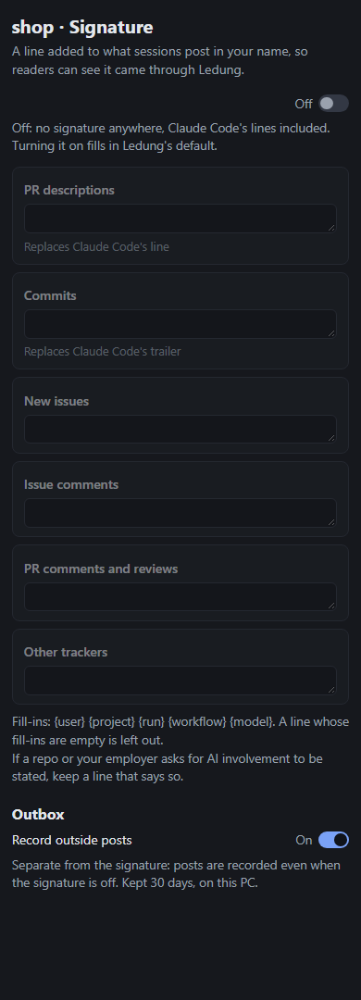

# A project signature — proposal

Nov 26, 2026, revised Nov 27 (Ledung's line replaces Claude Code's; then Simon's changes: a text per place, off is off, no PR summary; then one preset, Ledung's, editable, with Restore default and a small Off; an Outbox that records everything; no `Ledung-Run`) · Proposal for issue #513 (run-179). Not approved yet; nothing is built.

**Done when:** the "Done looks like" points of #513 hold, minus the living PR summary: a signature per project, Ledung's default or edited by hand, with a text per place and an Off; `gh` issue create, issue and PR comments and reviews get it from every body source on Windows and Mac, and PR descriptions and commits through Claude Code's own settings; every other `gh` call is unchanged; another server's write tool gets it after one question per tool and project; an Outbox records every outside post, signed or not, for 30 days; and never a second signature, one on a read-only call, a private detail in one, or a broken `gh`.

## Why

Sessions write issues, comments, PRs and commits on GitHub and other trackers in the person's name. People reading them can't tell that the work came through Ledung. Simon talked it through on 2026-11-26 and liked the direction: a short, factual line per project that the person can change or turn off, added by Ledung.

The signature is a **courtesy line, not proof**. A session can always reach the real `gh` or the site; nothing here is a security boundary, so it never blocks work.

## What Simon decided on 2026-11-27

In conversation with the manager, relayed with his words; they go into `docs/decisions.md` when the design is approved.

- **Ledung handles the signatures:** "I still want Ledung to handle the signatures though."
- **One preset, Ledung's, and a text per place:** "for the presets. Let's just have the Ledung preset, and it's editable to turn into custom. With some way to restore it to the default. With a small off somehow that disables the signature and erases the text in the box." (Later on Nov 27; this replaces the earlier Claude Code standard · Ledung standard · None · Custom.) An empty text means nothing in that place.
- **Ledung's texts replace Claude Code's lines completely, and nothing is hardcoded:** "we're replacing it with a per project signature that the user can change." Both Claude Code lines come from the project's texts. "The co-authored by claude should work the same way, unless that steps on any of Anthropic's licence thingies. If the user wants to have it there, they can have it in the signature; otherwise they can change it." (Earlier, question #2434: "We should override Claude Code's signature.") What Anthropic's terms say is under "Anthropic's terms" below.
- **Off is off:** "If switched off, it should be off." Off means no line anywhere, Claude's included.
- **Defaults:** "existing projects should remain as is, new projects use a Ledung standard." This replaces the earlier defaults by repo visibility. How an existing project looks with only one preset is open choice 6.
- **The Outbox records every outside post:** "I like the outbox changes we mentioned", about the manager's proposal: its own per-project setting, on by default, separate from the signature; the stand-in always there; tracker writes and board posts included; one line on what it can't see; local, 30 days.
- **No `Ledung-Run` trailer:** "Drop it." (15:42, on the manager's recommendation). It only linked a commit to a run inside this Ledung, which outsiders can't open, and would sit in every Ledung user's run commits. Anyone who wants it can type `Ledung-Run: {run}` into their commit text.
- **No living PR summary:** "I don't think it's up to Ledung, but each project's workflow. If I want to comment every time we start a new phase of an issue, then I can have that in the workflow." A PR made in a run gets the PR-description text like any other PR.

## Anthropic's terms (checked 2026-11-27)

Nothing found requires keeping Claude Code's lines, and Claude Code's own documentation offers changing and hiding them:

- **Claude Code settings reference** (code.claude.com/docs/en/settings-reference, "Git and attribution"): `attribution.commit` "Set the attribution text Claude Code adds to git commits, including any trailers. Set it to an empty string to hide commit attribution." `attribution.pr` likewise, and "To hide all attribution, set `attribution` to `false`." The docs give examples that replace the trailer with a custom one. The defaults are `Co-Authored-By: <name> <noreply@anthropic.com>` (the name is the model making the commit, such as `Claude Sonnet 5`, or a subagent's model) and `🤖 Generated with [Claude Code](https://claude.com/claude-code)`.
- **Usage Policy** (anthropic.com/legal/aup): no labelling requirement for code, commits or PRs. The rules that touch the subject are general: don't "plagiarize or submit AI-assisted work without proper permission or attribution", no "bots that claim to be human", and disclosure duties for consumer-facing chatbots and high-risk advice (legal, medical, finance, employment), none of which a commit line is. Even there: "Users do not need to identify Anthropic, Claude, or the model used."
- **Consumer Terms and Commercial Terms:** no sentence about labelling outputs or keeping attribution; the Consumer Terms forbid using the services "to deceive any person".

So removing or replacing the lines is a supported choice. The one thing left to the person is where a place requires disclosure (a repo's contribution rules that ask for AI involvement to be stated, an employer's policy): that is the project's text to set, and the settings say so in one line. This is a reading of the published pages, not legal advice.

## The two checks (done 2026-11-26)

1. **Can a hook change another MCP server's tool call? Yes.** A throwaway stdio MCP server (`tracker`, tool `create_comment`) ran under the Agent SDK 0.3.295 / Claude Code 2.1.319 with Haiku. A `PreToolUse` hook returning only `hookSpecificOutput.updatedInput` (no `permissionDecision`) changed the body. The server received `"hello\n\n— via Ledung"`. Importantly, **the permission check still ran**: `canUseTool` was called with the signed input, so the person approves the text that will actually go out. With the tool in `allowedTools`, it went through signed without a prompt, as before. The hook input also names the server (`mcp_server: {name, source}`).
2. **Does a stand-in `gh` work on Windows? Yes, as a shell script and a `.ps1`, not as a `.cmd`.** A folder with the stand-in put ahead of the real `gh` on `PATH`:
   - **Git Bash** (Claude Code's Bash tool on Windows; also macOS, Linux): an extensionless `gh` shell script (`exec node gh.mjs "$@"`) is found first. Arguments arrive exactly (`50% & <done> "q" !x ^y $HOME`), stdin passes through (`--body-file -`), and the real `gh`'s output and exit codes (0, 1) come back unchanged.
   - **PowerShell 5.1**: a `gh.ps1` is picked before the real `gh.exe`. It passes stdin only when written to forward `$input`; the first version hung on a pipe. Embedded `"` are lost, but that is PowerShell 5.1's own native-argument behaviour and happens with the real `gh.exe` too. **Risk:** Windows' default execution policy (`Restricted`) refuses a `.ps1`, which would turn `gh` into an error. See open choice 3.
   - **cmd**: a `gh.cmd` can't pass arguments safely. cmd re-reads `%`, `&`, `^` and `!` in `%*`, and in the test the body arrived split into pieces. So there is no `.cmd`. cmd skips the extensionless script and finds the real `gh.exe`: unsigned, but intact.
   - **Signing and falling back** (a prototype `gh.mjs`, Git Bash): a body from `--body-file <file>`, from `-F -` (stdin) and from `--body` came out signed as `<body>\n\n— via Ledung for Simon\n<!-- ledung run-0 -->`. A body that already had the marker was passed on unchanged. With the session file missing, or a simulated bug in the stand-in, the real `gh` ran with the original arguments. `gh --version` gave the same output and exit 0, and a failing `gh issue comment … --repo <nonexistent>` gave the same error and exit 1 as the real `gh` called directly. Two things the prototype showed that the real one must do: when falling back, say nothing on stderr (the reason goes to the journal instead), and keep stdin it has already read so it can be handed to the real `gh`.
   - **Mac, reasoned only:** the shell-script stand-in is the Git Bash case. zsh and bash look up `PATH` in order, `exec` keeps the exit code, and Node is there because Ledung runs on it. The only difference is the real `gh`'s path (`/opt/homebrew/bin/gh` or `/usr/local/bin/gh`), which Ledung finds when the session starts. One run on a Mac is still needed, in part 2.

## What it does

### The signature, per project

In the project's settings, a **Signature** section: a text per place, filled from Ledung's default, a **Restore default** link, and a small **Off** switch.

**The places:** PR descriptions · commits · new issues · issue comments · PR comments and reviews · other trackers. Each has its own text; an empty text means nothing is added there.

**Ledung's default** (what it says is open choice 4):

| Place | Ledung's default |
|---|---|
| PR descriptions | `— via Ledung for {user}` |
| Commits | `Co-Authored-By: {model} <noreply@anthropic.com>` |
| New issues | `— via Ledung for {user}` |
| Issue comments | — |
| PR comments and reviews | — |
| Other trackers | — |

It puts Ledung's line on PRs and new issues and keeps the co-author trailer on commits. Comments, reviews and trackers stay quiet: they are mostly conversation and work tools.

**Three states, one preset:**

- **Default:** the texts are exactly Ledung's default. The section says "Ledung's default".
- **Edited:** any change to any text makes the section say "Edited" (Simon's "custom"). Nothing else changes; the texts are simply what is saved. **Restore default** puts Ledung's default back in every box, after a "Replace your texts with Ledung's default?" confirmation, and is only shown while the texts are edited.
- **Off:** a small switch at the top of the section. Switching it off empties every box and greys them out, and saves that: **no line anywhere**, no Ledung line, no Claude line, no marker, no tracker question. The Outbox still records: it is its own setting. The edited texts are not kept (Simon: "erases the text in the box"), so the switch says "Turning it off clears your texts." **Switching it on again** fills the boxes with Ledung's default (open choice 7).

There is no Claude Code preset and no None preset: Off is the None, and Claude's own lines are just text a person can type into the boxes, or keep (open choice 6 for existing projects).

**Fill-ins:** `{user}` (Ledung's user name), `{project}` (the project's name), `{run}` (`run-179`), `{workflow}` (the flow's name) and `{model}` (the session's model as Claude Code names it, `Claude Opus 5.5`). Outside a run, the run fill-ins are empty, and a line left empty by them is dropped. Ledung's default no longer uses `{run}` or `{workflow}`; they stay as fill-ins because they cost nothing and a person may want them in their own text, though a reader outside this Ledung can't open a run. Only these five exist: session titles, folder paths, account names and anything else private can't be put in a signature, because there is no fill-in for them. Every text is checked against the project's sensitive patterns on save, as board posts are. (`{steps}` went with the PR summary.)

**Existing and new projects:** a project made in Ledung after this ships (New project, or the Ledung Helper) is saved with Ledung's default. A project with no signature setting (every project that exists today, and one added to the config by hand) keeps exactly what it gets today: Claude Code's own PR line and commit trailer, and nothing else. How the section shows that is open choice 6. Either way it is recorded in the Outbox like any project.

**Where the settings live: the project's settings, not the workflow.** Whether and how a project signs is about the repo and who reads it, and it applies to work outside a run too. Saved like the other project settings, in the project's part of the config, so a work project's text can stay in `ledung.config.local.json`. A change reaches PR descriptions and commits for sessions started or resumed afterwards (Claude Code takes those at the start; part 1 checks whether a running session can be updated), and everything else on the next call.

### PR descriptions and commits: Claude Code's own settings

Claude Code adds its lines from two settings: `attribution.pr` and `attribution.commit`. Claude writes both itself, as text it is told to add, so a stand-in can't reliably take them out afterwards. Ledung sets them instead, per session, through the SDK's `settings` option, which ranks above the person's own Claude Code settings for that session only. The person's settings files are never changed, and sessions outside Ledung keep whatever those files say.

| The project's text for the place | What Ledung sets for the session |
|---|---|
| No signature setting (an existing project, untouched) | nothing: Claude Code's own defaults, exactly as today |
| A text (Ledung's default or edited) | `attribution.pr` / `attribution.commit` = that text, filled in |
| Empty (emptied by hand) | an empty string: no line in that place |
| Off | `attribution: false`: no line at all |

Leaving an untouched existing project alone keeps "as is" literal: Claude's own trailer names the model making each commit, including a subagent's, and a person's own `attribution` settings still apply. Once a text is set, `{model}` is the session's model at the start, refilled if Ledung switches the model; a commit made by a subagent on another model then names the session's model. That is the one difference from Claude's own trailer, and it only arises once a project's texts are set.

Because Claude Code adds the PR line itself, it is there in every shell and in container sessions too. A PR description gets its line only this way: the stand-in doesn't sign `gh pr create`, so there is never a second line on a PR. Commits get no marker; a trailer is plain to read. No git hooks are installed in anyone's repository.

Not checked yet, so done first in part 1: that the SDK's `settings` option wins over a person's own `attribution` for that session, and that an empty string gives no line rather than Claude's default.

### The marker, where it is still needed

The stand-in and the tracker hook add the text to a body that someone else (Claude) wrote, so they need a way to see they already did. Every body they sign ends with the text, then a hidden marker where the site renders Markdown: `<!-- ledung run-179 -->`, or `<!-- ledung -->` outside a run. A call that is only recorded gets no marker. Before signing, the body is searched for `<!-- ledung`; if it is there, nothing is added. That covers a repeated post, a body copied from an earlier one and a session that signed by hand. Edits (`gh issue edit`, `gh pr edit`, `gh api … PATCH`) are never signed. PR descriptions and commits carry no marker: Claude Code adds their line once, and nothing else adds one.

**When a tracker strips the marker (Linear, Jira and others),** Ledung never relies on it coming back. Two other checks keep "never a second signature":

- **The text check:** a body that already ends with the project's filled-in text for that place, or contains `via Ledung`, is left alone.
- **Ledung's own record:** each signed call is journalled (tool, the target's id, such as the issue key, and a hash of the body). The same tool, target and body within a day is a repeat and is not signed again.

For trackers whose Markdown keeps HTML comments, the marker is added as on GitHub. Whether one does is found out in part 3, per tracker, not assumed.

### GitHub: the stand-in `gh`

Ledung writes a small stand-in into its data folder (`<data>/gh-stand-in/`, via `src/platform/paths.ts`): a `gh` shell script, and if chosen a `gh.ps1`, both calling one `gh.mjs` run by Ledung's own Node. Because the Outbox records every outside post, **the folder is first on `PATH` in every local session** (`sessionEnv`), whatever the signature says. It is left out only when a project has both recording switched off and no text for the stand-in's places. A per-session file next to it holds the real `gh`'s full path (found when the session starts), the three places' texts already filled in, whether to record, and the run. No `LEDUNG_*` variable is used, so the rule "sessions don't inherit LEDUNG_* settings" stays as it is.

`gh.mjs` reads its arguments, not a command line:

- **It records** `issue create`, `issue comment`, `issue edit`, `pr create`, `pr comment`, `pr review`, `pr edit`, and `gh api` calls that write (`-X`/`--method` `POST`, `PATCH`, `PUT` or `DELETE`, or a `-f`/`-F`/`--input` field without `-X`, which makes `gh api` post). Everything else, `gh api` reads included, is not recorded.
- **It signs** only `issue create`, `issue comment`, `pr comment` and `pr review` (with `--comment`, `--approve` or `--request-changes` and a body), and only when that place has a text. Edits, `pr create` and `gh api` are never signed. A call whose place has no text goes to the real `gh` unchanged and is only recorded.
- It takes a body to sign from `--body`/`-b`, `--body-file`/`-F` (a file, or `-` for stdin), and writes the signed body to a temporary file passed as `--body-file`. Stdin is read only when the call itself reads it and the stand-in signs it; a call that is only recorded keeps its stdin untouched.
- A call with no body of its own (`--fill`, `--web`, `--editor`, interactive) is passed through unchanged, and recorded if it is one of the kinds above.
- Every other call `exec`s the real `gh` with the same arguments, stdin, stdout and exit code.
- After a recorded call it appends one line to the session's journal: kind, repo, the URL `gh` printed (for `gh api`, the method and path), whether it was signed (for `pr create`, whether the body holds the project's PR text, which Claude Code added), the time. No body is kept. That journal feeds the Outbox.

**The fallback, stressed, because the stand-in is now in every session.** A broken stand-in must never become a broken `gh`:

- **Any failure in the stand-in** (missing or unreadable session file, a bug, an argument it can't parse, the journal not writable) runs the real `gh` with the original arguments and stdin, untouched. Only the real `gh`'s own failures are reported as failures.
- It is silent: nothing of its own on stdout or stderr. The reason goes to the journal, and the Outbox shows "N calls passed through unrecorded" for that session, so a fault is visible without breaking anything.
- Recording happens after the real `gh` has finished, from its output. A failing journal write never changes the output or the exit code.
- The shell script only starts Node with `gh.mjs`. If Node can't start, the script `exec`s the real `gh` path from the session file, and failing that, the next `gh` on `PATH` after its own folder.
- Part 2's tests run the `gh` calls sessions make every day (`gh pr view`, `gh pr checks`, `gh run watch`, `gh auth status`, `gh api` reads, a prompt that waits for input) through the stand-in and compare output and exit codes with the real `gh`, and one test removes the session file and one breaks `gh.mjs` on purpose.

Container sessions run `gh` inside the container, which Ledung doesn't write to today. See open choice 2. Their PRs and commits get the project's lines anyway, through Claude Code's settings; their `gh` posts are not recorded.

### Other trackers: recorded always, signed after one question

Ledung's existing hook gets one more step for `mcp__*` tools of servers that aren't Ledung's own.

- **Which tools count as writes:** those not marked `readOnly` in the server's own tool list (`mcpServerStatus()`, which gives name, description and annotations, but no input schema), whose name or description says create, add, post, comment, reply, update, edit or delete. The same list decides both recording and signing.
- **Recording, whatever the signature says:** a `PostToolUse` step writes a journal line for every such call while the project records: server, tool, the target's id, any URL found in the result, whether it was signed, the time. No body is kept.
- **Signing, only when the other-trackers text isn't empty**, and only for a write tool with at least one string field. The first call of such a tool in a project goes through **unsigned**. The project's settings get a waiting item, with a small badge on the project: "Linear: create_comment. Which field gets the signature?", offering the call's string fields (`body`, `title`, …) and "None". The answer is kept per project and tool. Every later call has the text added to that field as the call passes (`PreToolUse`, the check-1 mechanism), and the server's own sign-in is untouched. See open choice 1 for asking during the call instead.
- **Fitting into the hook chain:** the signed input is worked out first. Every `allow` the chain returns afterwards (grants, rules, away mode) carries it as `updatedInput`, and an "ask" carries it too, so the person approves the signed text. A refusal stays a refusal. A signature is never added to a call that Ledung or the person would refuse, and a refused call isn't recorded, because nothing went out.
- A failure in either step lets the call go through as it was, unsigned and unrecorded, with the reason in the journal.

### The Outbox

**A record of every outside post the sessions make, signed or not.** It is its own per-project setting, **Record outside posts**, on by default and separate from the signature: a project whose signature is Off, or an existing project still on Claude Code's own lines, is recorded all the same. Switching it off stops recording for that project from the next call; what was recorded stays until it ages out.

**What it records:**

- GitHub, through the stand-in: new issues, issue comments and edits, PRs, PR comments, reviews and edits, and `gh api` calls that write.
- Other trackers' write tools, through the hook.
- **Ledung's own board posts** (what sessions post through Ledung's board tools, once sent), from Ledung's own record, so the Outbox is one list of everything that left.

**What is shown:** newest first: when, the kind (issue, comment, PR, review, edit, API write, a tracker's comment, board post), a link to the post (for an API write, the method and path), signed or not, the project, the run (a link to it), and the session (a link to it; session titles are shown only here, inside Ledung, never in a signature). It can be filtered by project and run, or "Not in a run". Under the title, one line says what it can't see: "Not recorded: `gh` from PowerShell or cmd, sessions in containers (for now), and posts made with curl or your own scripts." Commits are not listed: they go out with a push, and the branch already shows them.

**Where it is kept:** locally, in Ledung's database (a new `MIGRATIONS` entry), filled from the journals, the hook's record and the board. It is **kept 30 days**, then trimmed, and sent nowhere. At 1280 px it is a table. At 390 px each entry is a card of two lines: the kind and the link, cut off with "…", then project · run · time · session · signed. Where it lives is open choice 5. The board's held posts are also called an outbox in the code (PR #131), but the page never shows that word, so the name is free.

## What is shown

Mock-ups, static, dark mode, made-up projects (`project-signature/settings-mock.html`, `project-signature/outbox-mock.html`):

**Project settings → Signature:** the small Off switch, "Ledung's default" or "Edited" with Restore default, a text per place with a note on what it replaces, the fill-ins, a preview filled in for a sample run, one line on disclosure, and the list of tracker tools with their chosen field (changeable, or "None").

The same section switched Off (`settings-mock.html?off`): every box empty and greyed, "No signature anywhere, Claude Code's lines included."

Below the signature, the Outbox's own switch, **Record outside posts**, on by default.

**A waiting badge** on the project when a tracker tool's field is still unchosen.

**Outbox:** the line on what it can't see, a Signed column, edits, an API write and a board post among the entries.

## Security

- No new opening in the page or API. The stand-in talks to nothing but the real `gh` and a file in the data folder. It never calls Ledung.
- The per-session file holds no token, only the real `gh`'s path, the texts, the recording switch and the run. A session can read or change it (same user). That only changes its own courtesy line, and the session could post through the real `gh` anyway.
- The real `gh` is found once by Ledung (full path), so the stand-in can't call itself in a loop. It also refuses to `exec` a path inside its own folder.
- A signature can only contain the five fill-ins and the person's own text, which is checked against the sensitive patterns. No private details can leak through it.
- The Outbox keeps no bodies, only kind, link, target, time and whether it was signed; it is local, only shown behind Ledung's sign-in, and trimmed after 30 days.
- The stand-in is now in every local session, so its fallback (above) is tested as a part of its own: a fault means an unrecorded call, never a failed one.
- The hook change never turns an ask into an allow or skips a refusal (check 1). The person sees the signed text.
- Claude Code's lines are changed only for Ledung's own sessions, through the SDK's per-session settings. The person's Claude Code settings files are never written.

## Parts

Each part is its own PR, reviewed and approved on its own. Part 1 comes first: it adds the settings (the recording switch included), Ledung's default and the journal, and on its own already gives PRs and commits the project's lines. Parts 2 and 3 depend only on part 1 and can go in either order. Part 4 needs part 2 or 3 for something to list.

| # | Part | Done when | Session time | Plan use |
|---|---|---|---|---|
| 1 | **Settings, Ledung's default and Claude Code's lines:** the Signature section (a text per place, Default / Edited, Restore default, the Off switch that empties the boxes, fill-ins with `{model}`, preview, sensitive check), existing projects left on Claude Code's own lines (open choice 6) and Ledung's default for new ones, `attribution` per session, the journal file. | First the two checks under "PR descriptions and commits". Then, in a throwaway Ledung with Haiku: an existing project's session makes a PR and a commit exactly as today; a new project's (Ledung's default) PR ends with `— via Ledung for …` and no Claude line, and its commit carries `Co-Authored-By: Claude Haiku …` and nothing else; switched Off, neither has any line and the boxes are empty; an edited text shows up as typed; Restore default brings back the default texts. The person's own Claude Code settings file is unchanged. Settings work at 390 px. | 60–90 min | medium: one build session plus review |
| 2 | **The stand-in `gh`** (local sessions): on `PATH` in every local session, recording the listed commands and writing `gh api` calls, signing the four commands from all three body sources when a text applies, the marker and its check, the silent fallback, journal lines. | Tests cover each command and body source, pass-through (same output and exit code) for the everyday `gh` calls, a recorded-only call passing unchanged, `pr create` and edits left unsigned, `gh api` reads not recorded, and the fallback (missing session file, broken `gh.mjs`, Node not starting, journal not writable). A throwaway Ledung on Windows signs a real issue and comment in a throwaway repo from Git Bash; a repeated post isn't signed twice. One run on a Mac. | ≈ 105 min | medium |
| 3 | **Other trackers:** picking out write tools, recording every write (`PostToolUse`), the one-time field question, the signing step and how it fits the chain, the repeat check without a marker. | The check-1 tracker server, under a throwaway Ledung, asks once and signs every later call. A read-only tool is never touched. A refused call stays refused. A repeated call isn't signed twice. With an empty trackers text, nothing is asked or signed, but writes are still recorded. | 60–90 min | medium |
| 4 | **Outbox:** database entry, Ledung's board posts added, the 30-day trim, list, filters, the Signed column, the line on what it can't see, the page at both widths. | It lists parts 2–3's posts and the board's, signed and unsigned, with links, per project and run; a project with the signature Off is still listed; with recording off, nothing new appears; an entry older than 30 days is gone; it works at 1280 and 390 px (dark-mode screenshots beside this mock-up). | ≈ 75 min | medium (page and screenshots) |

About 5 to 6 hours of session time in all, in four PRs: about 30 minutes more than before, for recording every post (stand-in and fallback tests in part 2, board posts and the trim in part 4). Each part also waits for code review, CI and Simon's sign-off. No measured figures from Ledung exist for this kind of work yet, so plan use is only relative.

## Open choices

1. **A tracker tool's first use: ask during the call, or after?**
   - **(a) After (recommended):** the first call goes unsigned and a waiting item asks which field. Nobody's work stops for a courtesy line.
   - (b) During: the call waits until the person picks a field. This matches #513's "asks once" literally, but holds a session on something cosmetic, possibly for hours.
2. **The stand-in in container sessions.**
   - **(a) Later (recommended):** part 2 covers local sessions. In a container, issues and comments go out unsigned through the real `gh`; PRs and commits are still signed through Claude Code's settings. Copying a stand-in into someone's container (`docker cp`, with or without Node there) is its own small design.
   - (b) In part 2, with a POSIX `sh`-only stand-in.
3. **PowerShell.**
   - **(a) No `gh.ps1` for now (recommended):** PowerShell finds the real `gh.exe`, so issues and comments from PowerShell go unsigned but never break. Git Bash is Claude Code's shell on Windows.
   - (b) Write `gh.ps1` only when Ledung finds the execution policy allows scripts.
4. **What Ledung's default says.**
   - **(a) As in the table (recommended, the manager's suggestion):** PR descriptions and new issues `— via Ledung for {user}`; commits `Co-Authored-By: {model} <noreply@anthropic.com>`; comments, reviews and trackers empty. The co-author trailer stays because it says honestly, in a form GitHub reads, that Claude wrote the code; the PR line changes because "Generated with Claude Code" is the courtesy line Ledung's replaces.
   - (b) The same, but commits `Via: Ledung for {user}`, without the co-author trailer: one Ledung line everywhere, but the commit no longer says Claude co-wrote it.
   - (c) The same as (a), plus issue comments and PR comments and reviews `— via Ledung`: more visible, more noise in conversations.
5. **Where the Outbox lives.**
   - **(a) A sidebar entry next to runs, as in the mock-up (recommended):** one place across projects, with filters.
   - (b) A tab in each project's settings.
6. **How an existing project shows in the Signature section.** It has no setting and must keep exactly today's lines.
   - **(a) As edited text holding Claude Code's two lines (recommended):** the PR box shows `🤖 Generated with [Claude Code](https://claude.com/claude-code)`, the commit box `Co-Authored-By: {model} <noreply@anthropic.com>`, the rest empty, marked "Edited" with Restore default beside it. While those boxes are untouched, Ledung saves nothing and sets nothing, so Claude Code's own lines go out exactly as today (a subagent's model included). Once anything is changed, it is saved like any edited text. One preset, one way to read the section: the boxes show what goes out.
   - (b) A separate note instead of boxes: "This project uses Claude Code's own lines, as before. Use Ledung's signature?" with a button. Plainer, but a fourth state beside Default, Edited and Off, which Simon's one-preset choice was meant to avoid. The manager suggested this one: an existing project gets nothing from Ledung, and the section says so and offers Ledung's default. I still recommend (a), because the boxes then always show what goes out, but both keep the project exactly as today.
7. **Switching Off back on.** Off has already erased the texts.
   - **(a) The boxes fill with Ledung's default (recommended):** on means signed, and "on with every box empty" would be a second Off. Editing from there is the same as always.
   - (b) The boxes stay empty until the person types or presses Restore default: nothing appears that the person didn't put there, but until then on behaves like Off.
