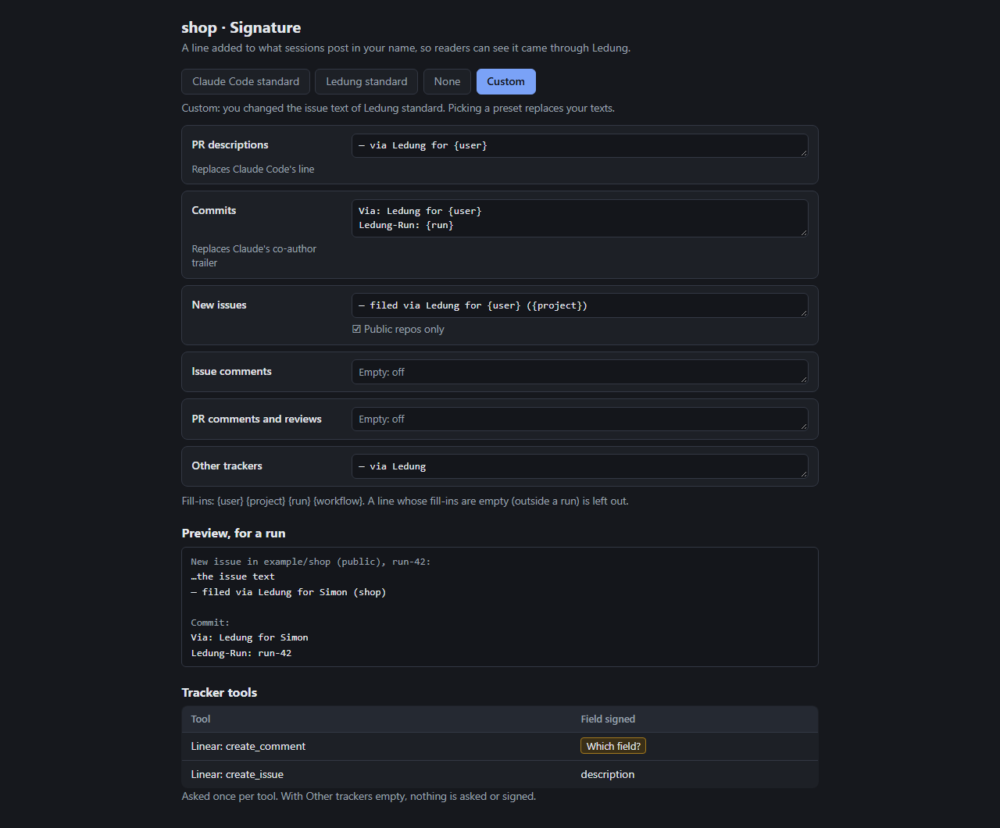
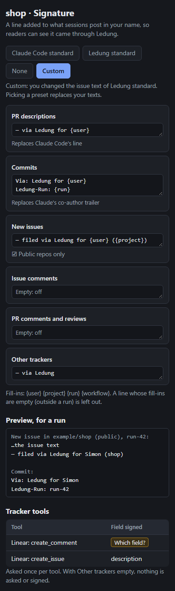
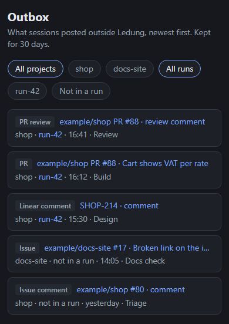

# A project signature — proposal

Nov 26, 2026, revised Nov 27 twice (Ledung's line replaces Claude Code's; then presets, a text per place, no PR summary) · Proposal for issue #513 (run-179). Not approved yet; nothing is built.

**Done when:** the "Done looks like" points of #513 hold, minus the living PR summary: a signature per project, set by a preset or by hand, with a text per place; `gh` issue/PR create, comment and review get it from every body source on Windows and Mac; every other `gh` call is unchanged; another server's write tool gets it after one question per tool and project; an Outbox lists what went out; and never a second signature, one on a read-only call, a private detail in one, or a broken `gh`.

## Why

Sessions write issues, comments, PRs and commits on GitHub and other trackers in the person's name. People reading them can't tell that the work came through Ledung. Simon talked it through on 2026-11-26 and liked the direction: a short, factual line per project that the project can change or turn off, and a hidden marker that lets Ledung find its own posts again (no double signatures, a list of what went out).

The signature is a **courtesy line, not proof**. A session can always reach the real `gh` or the site; nothing here is a security boundary, so it never blocks work.

## What Simon decided on 2026-11-27

Relayed by the manager (Simon talked it over with the manager, not on the review). These replace the earlier open choices 4, 6 and 7 and the living PR summary; they go into `docs/decisions.md` when the design is approved.

- **Presets:** Claude Code standard · Ledung standard · None. Editing any text makes it **Custom**.
- **A text per place**, not one text with switches.
- **Ledung replaces Claude's lines fully**, the commit trailer included (earlier: question #2434, "We should override Claude Code's signature.").
- **Off is off:** "If switched off, it should be off." No Ledung line and no Claude line.
- **Existing projects stay as they are; new projects get Ledung standard.**
- **No living PR summary:** "I don't think it's up to Ledung, but each project's workflow." A workflow that wants a summary writes one in its own steps.

## The two checks (done 2026-11-26)

1. **Can a hook change another MCP server's tool call? Yes.** A throwaway stdio MCP server (`tracker`, tool `create_comment`) ran under the Agent SDK 0.3.295 / Claude Code 2.1.319 with Haiku. A `PreToolUse` hook returning only `hookSpecificOutput.updatedInput` (no `permissionDecision`) changed the body. The server received `"hello\n\n— via Ledung"`. Importantly, **the permission check still ran**: `canUseTool` was called with the signed input, so the person approves the text that will actually go out. With the tool in `allowedTools`, it went through signed without a prompt, as before. The hook input also names the server (`mcp_server: {name, source}`).
2. **Does a stand-in `gh` work on Windows? Yes, as a shell script and a `.ps1`, not as a `.cmd`.** A folder with the stand-in put ahead of the real `gh` on `PATH`:
   - **Git Bash** (Claude Code's Bash tool on Windows; also macOS, Linux): an extensionless `gh` shell script (`exec node gh.mjs "$@"`) is found first. Arguments arrive exactly (`50% & <done> "q" !x ^y $HOME`), stdin passes through (`--body-file -`), and the real `gh`'s output and exit codes (0, 1) come back unchanged.
   - **PowerShell 5.1**: a `gh.ps1` is picked before the real `gh.exe`. It passes stdin only when written to forward `$input`; the first version hung on a pipe. Embedded `"` are lost, but that is PowerShell 5.1's own native-argument behaviour and happens with the real `gh.exe` too. **Risk:** Windows' default execution policy (`Restricted`) refuses a `.ps1`, which would turn `gh` into an error. See open choice 3.
   - **cmd**: a `gh.cmd` can't pass arguments safely. cmd re-reads `%`, `&`, `^` and `!` in `%*`, and in the test the body arrived split into pieces. So there is no `.cmd`. cmd skips the extensionless script and finds the real `gh.exe`: unsigned, but intact.
   - **Signing and falling back** (a prototype `gh.mjs`, Git Bash): a body from `--body-file <file>`, from `-F -` (stdin) and from `--body` came out signed as `<body>\n\n— via Ledung for Simon\n<!-- ledung run-0 -->`. A body that already had the marker was passed on unchanged. With the session file missing, or a simulated bug in the stand-in, the real `gh` ran with the original arguments. `gh --version` gave the same output and exit 0, and a failing `gh issue comment … --repo <nonexistent>` gave the same error and exit 1 as the real `gh` called directly. Two things the prototype showed that the real one must do: when falling back, say nothing on stderr (the reason goes to the journal instead), and keep stdin it has already read so it can be handed to the real `gh`.
   - **Mac, reasoned only:** the shell-script stand-in is the Git Bash case. zsh and bash look up `PATH` in order, `exec` keeps the exit code, and Node is there because Ledung runs on it. The only difference is the real `gh`'s path (`/opt/homebrew/bin/gh` or `/usr/local/bin/gh`), which Ledung finds when the session starts. One run on a Mac is still needed, in part 2.

## What it does

### The signature, per project

In the project's settings, a **Signature** section with a preset and a text per place.

**The places:** PR descriptions · commits · new issues · issue comments · PR comments and reviews · other trackers. Each has its own text; an empty text means that place is off.

**The presets:**

| Place | Claude Code standard | Ledung standard | None |
|---|---|---|---|
| PR descriptions | Claude Code's own line | `— via Ledung for {user}` | — |
| Commits | Claude Code's own trailer | `Via: Ledung for {user}` and, in a run, `Ledung-Run: {run}` (open choice 4) | — |
| New issues | — | `— via Ledung for {user}`, public repos only (open choice 5) | — |
| Issue comments | — | — | — |
| PR comments and reviews | — | — | — |
| Other trackers | — | — | — |

- **Claude Code standard** is what happens today: Ledung touches nothing, Claude Code adds its lines as the person's own Claude Code settings say, and the stand-in and the hook add nothing. Its texts are shown read-only, as Claude Code's defaults ("🤖 Generated with [Claude Code](https://claude.com/claude-code)", `Co-Authored-By: Claude <noreply@anthropic.com>`).
- **Ledung standard** replaces Claude's lines with Ledung's on PRs and commits, and signs new issues in public repos. Comments, reviews and other trackers stay quiet: they are mostly conversation and work tools.
- **None** means nothing anywhere: no Ledung line, no Claude line, no marker.
- **Custom:** editing any text, from any preset, switches the project to Custom with the texts as they stood, so "Claude Code standard but with a signed issue" is one edit. Picking a preset again overwrites the texts, after a "Replace your texts?" confirmation.

**Fill-ins:** `{user}` (Ledung's user name), `{project}` (the project's name), `{run}` (`run-179`) and `{workflow}` (the flow's name). Outside a run, the run fill-ins are empty and a line left empty by them is dropped. Only these four exist: session titles, folder paths, account names and anything else private can't be put in a signature, because there is no fill-in for them. Every text is checked against the project's sensitive patterns on save, as board posts are. (`{steps}` from the first version went with the PR summary.)

**Existing and new projects:** a project with no signature setting is Claude Code standard, so every existing project behaves exactly as today. A project made in Ledung (New project, or the Ledung Helper) is saved with Ledung standard. A project added to the config by hand has no setting, so it is Claude Code standard too.

**Where the settings live: the project's settings, not the workflow.** Whether and how a project signs is about the repo and who reads it, and it applies to work outside a run too. Saved like the other project settings, in the project's part of the config, so a work project's text can stay in `ledung.config.local.json`. A change applies to sessions started or resumed afterwards for PRs and commits (Claude Code reads those at the start), and to the next call for everything else.

**Public repos only:** a place can be limited to public repos (the Ledung standard has it on for new issues). Ledung reads a repo's visibility once (`gh repo view --json visibility`, through the session's runner) and keeps it; a repo whose visibility can't be read counts as private.

### Claude Code's lines: PR descriptions and commits

Claude Code adds its own lines from two settings: `attribution.pr` (the line at the end of a PR description) and `attribution.commit` (the `Co-Authored-By: Claude …` trailer). Claude writes both itself, as text it is told to add, so a stand-in can't take them out reliably afterwards. Ledung sets them instead, per session, through the SDK's `settings` option, which ranks above the person's own Claude Code settings for that session only. The person's settings file is never changed, and sessions outside Ledung keep Claude's lines.

| The project's text for the place | `attribution.pr` / `attribution.commit` |
|---|---|
| Claude Code standard | not set: the person's own settings apply |
| A text (Ledung standard or Custom) | that text, filled in; for PRs followed by the marker |
| Empty (None, or emptied by hand) | empty: no line at all |

So a PR carries one line, the project's, and Claude Code puts it there itself, also where the stand-in doesn't reach (PowerShell, a container). Where the stand-in does reach, it finds the marker and adds nothing. A commit carries the project's trailer and no `Co-Authored-By: Claude`, as Simon decided; a project that wants the co-author trailer back puts it in its commits text.

`attribution.pr` is one setting for the whole session, so "public repos only" can't apply to it per repo; it follows the project's own repo. No git hooks are installed in anyone's repository.

Not checked yet, so done first in part 1: that the SDK's `settings` option really wins over a person's own `attribution` for that session, and that an empty `attribution.pr` / `attribution.commit` gives no line rather than Claude's default.

### The marker

Every signed body ends with the signature, then a hidden marker where the site renders Markdown: `<!-- ledung run-179 -->`, or `<!-- ledung -->` outside a run. Before signing, the body is searched for `<!-- ledung`. If it is there, nothing is added. That covers a repeated post, a body copied from an earlier one, a PR whose line Claude already added through `attribution.pr`, and a session that signed by hand. Edits (`gh issue edit`, `gh pr edit`, `gh api … PATCH`) are never signed. Commits get no marker; a trailer is already plain to read.

**When a tracker strips the marker (Linear, Jira and others),** Ledung never relies on it coming back. Two other checks keep "never a second signature":

- **The text check:** a body that already ends with the project's filled-in text for that place, or contains `via Ledung`, is left alone.
- **Ledung's own record:** each signed call is journalled (tool, the target's id, such as the issue key, and a hash of the body). The same tool, target and body within a day is a repeat and is not signed again.

For trackers whose Markdown keeps HTML comments, the marker is added as on GitHub. Whether one does is found out in part 3, per tracker, not assumed.

### GitHub: the stand-in `gh`

Ledung writes a small stand-in into its data folder (`<data>/gh-stand-in/`, via `src/platform/paths.ts`): a `gh` shell script, and if chosen a `gh.ps1`, both calling one `gh.mjs` run by Ledung's own Node. Ledung puts that folder first on the session's `PATH` in `sessionEnv`. A per-session file next to it holds the real `gh`'s full path (found when the session starts), each place's text already filled in, the public-only limits, the known repo visibilities, and the run. No `LEDUNG_*` variable is used, so the rule "sessions don't inherit LEDUNG_* settings" stays as it is. A project on Claude Code standard or None gets no stand-in on its `PATH` at all.

`gh.mjs` reads its arguments, not a command line:

- It signs only `issue create`, `issue comment`, `pr create`, `pr comment` and `pr review` (with `--comment`, `--approve` or `--request-changes` and a body), and only when that place has a text (and, if limited, the target repo is public).
- It takes the body from `--body`/`-b`, `--body-file`/`-F` (a file, or `-` for stdin), and writes the signed body to a temporary file passed as `--body-file`. Stdin is read only when the call itself reads it.
- A call with no body of its own (`--fill`, `--web`, `--editor`, interactive) is passed through unchanged.
- Every other call `exec`s the real `gh` with the same arguments, stdin, stdout and exit code.
- **Any failure in the stand-in** (missing or unreadable session file, a bug, an argument it can't parse) runs the real `gh` with the original arguments, untouched. Only the real `gh`'s own failures are reported as failures.
- After one of the five calls, signed or already carrying the marker, it appends one line to the session's journal: kind, repo, the URL `gh` printed, the time. That journal feeds the Outbox. A fallback writes its reason there too, never to stderr.

Container sessions run `gh` inside the container, which Ledung doesn't write to today. See open choice 2. PR descriptions and commits are signed there anyway, through Claude's own settings.

### Other trackers: one question per tool, then a hook

Only when the project's other-trackers text isn't empty. Ledung's existing `PreToolUse` hook gets one more step for `mcp__*` tools of servers that aren't Ledung's own:

- **Which tools count as writes:** those not marked `readOnly` in the server's own tool list (`mcpServerStatus()`, which gives name, description and annotations, but no input schema), whose name or description says create, add, post, comment, reply or update, and whose call has at least one string field.
- **The first call** of such a tool in a project goes through **unsigned**. The project's settings get a waiting item, with a small badge on the project: "Linear: create_comment. Which field gets the signature?", offering the call's string fields (`body`, `title`, …) and "None". The answer is kept per project and tool. Every later call has the text added to that field as the call passes (the check-1 mechanism), and the server's own sign-in is untouched. See open choice 1 for asking during the call instead.
- **Fitting into the hook chain:** the signed input is worked out first. Every `allow` the chain returns afterwards (grants, rules, away mode) carries it as `updatedInput`, and an "ask" carries it too, so the person approves the signed text. A refusal stays a refusal. A signature is never added to a call that Ledung or the person would refuse.
- A `PostToolUse` step writes the same journal line, with any URL found in the result.

### The Outbox

A list of everything sessions posted outside, newest first: when, the kind (issue, comment, PR, review, a tracker's comment), a link to the post, the project, the run (a link to it), and the session (a link to it; session titles are shown only here, inside Ledung, never in a signature). It can be filtered by project and run, or "Not in a run". It is built from the journals and the hook's record, kept in the database (a new `MIGRATIONS` entry) for the evidence period, then trimmed. At 1280 px it is a table. At 390 px each entry is a card of two lines: the kind and the link, cut off with "…", then project · run · time · session. It is a sidebar entry next to runs (open choice 6). The board's held posts are also called an outbox in the code (PR #131), but the page never shows that word, so the name is free.

Commits are not listed: they go out with a push, not one by one, and the branch already shows them.

## What is shown

Mock-ups, static, dark mode, made-up projects (`project-signature/settings-mock.html`, `project-signature/outbox-mock.html`):

**Project settings → Signature:** the preset as four choices (Custom is chosen by editing, not picked), a text per place with "Public repos only" where it applies, a preview filled in for a sample run, and the list of tracker tools with their chosen field (changeable, or "None").

**A waiting badge** on the project when a tracker tool's field is still unchosen.

**Outbox:**

## Security

- No new opening in the page or API. The stand-in talks to nothing but the real `gh` and a file in the data folder. It never calls Ledung.
- The per-session file holds no token, only the real `gh`'s path, the texts, the limits, the visibilities and the run. A session can read or change it (same user). That only changes its own courtesy line, and the session could post through the real `gh` anyway.
- The real `gh` is found once by Ledung (full path), so the stand-in can't call itself in a loop. It also refuses to `exec` a path inside its own folder.
- A signature can only contain the four fill-ins and the person's own text, which is checked against the sensitive patterns. No private details can leak through it.
- The hook change never turns an ask into an allow or skips a refusal (check 1). The person sees the signed text.
- Claude's lines are changed only for Ledung's own sessions, through the SDK's per-session settings. The person's Claude Code settings files are never written.

## Parts

Each part is its own PR, reviewed and approved on its own. Part 1 comes first: it adds the settings, the presets and the journal, and on its own already gives PRs and commits the project's line. Parts 2 and 3 depend only on part 1 and can go in either order. Part 4 needs part 2 or 3 for something to list.

| # | Part | Done when | Session time | Plan use |
|---|---|---|---|---|
| 1 | **Settings, presets and Claude Code's lines:** the Signature section (presets, a text per place, Custom on edit, public-only, preview, sensitive check), Claude Code standard for projects without a setting and Ledung standard for new ones, `attribution.pr` / `attribution.commit` per session, the journal file. | First the two checks under "Claude Code's lines". Then, in a throwaway Ledung with Haiku: an existing project's session makes a PR and a commit exactly as today; a new project's (Ledung standard) PR ends with Ledung's line and marker and no Claude line, and its commit carries `Via: Ledung for …` (and `Ledung-Run` in a run) and no `Co-Authored-By: Claude`; with None, neither has any line; a Custom text shows up as typed. The person's own Claude Code settings file is unchanged. Settings work at 390 px. | 60–90 min | medium: one build session plus review |
| 2 | **The stand-in `gh`** (local sessions): on `PATH` only when some GitHub place has a text, signing the five commands from all three body sources, public-only, the marker and its check, a silent fallback, journal lines. | Tests cover each command and body source, pass-through (same output and exit code) and the fallback. A throwaway Ledung on Windows signs a real issue in a throwaway public repo from Git Bash and leaves a private one's unsigned; a PR already signed by Claude's setting gets no second line. One run on a Mac. | ≈ 90 min | medium |
| 3 | **Other trackers:** picking out write tools, the one-time field question, the hook step and how it fits the chain, the repeat check without a marker, the journal line. | The check-1 tracker server, under a throwaway Ledung, asks once and signs every later call. A read-only tool is never touched. A refused call stays refused. A repeated call isn't signed twice. With an empty trackers text, nothing is asked. | 60–90 min | medium |
| 4 | **Outbox:** database entry, list, filters, the page at both widths. | It lists parts 2–3's posts with links, per project and run, and works at 1280 and 390 px (dark-mode screenshots beside this mock-up). | ≈ 60 min | medium (page and screenshots) |

About 4½ to 5½ hours of session time in all, in four PRs. Each part also waits for code review, CI and Simon's sign-off. No measured figures from Ledung exist for this kind of work yet, so plan use is only relative.

## Open choices

1. **A tracker tool's first use: ask during the call, or after?**
   - **(a) After (recommended):** the first call goes unsigned and a waiting item asks which field. Nobody's work stops for a courtesy line.
   - (b) During: the call waits until the person picks a field. This matches #513's "asks once" literally, but holds a session on something cosmetic, possibly for hours.
2. **The stand-in in container sessions.**
   - **(a) Later (recommended):** part 2 covers local sessions. In a container, issues and comments go out unsigned through the real `gh`; PRs and commits are still signed through Claude's settings. Copying a stand-in into someone's container (`docker cp`, with or without Node there) is its own small design.
   - (b) In part 2, with a POSIX `sh`-only stand-in.
3. **PowerShell.**
   - **(a) No `gh.ps1` for now (recommended):** PowerShell finds the real `gh.exe`, so issues and comments from PowerShell go unsigned but never break. Git Bash is Claude Code's shell on Windows.
   - (b) Write `gh.ps1` only when Ledung finds the execution policy allows scripts.
4. **Ledung standard's commit text.**
   - **(a) `Via: Ledung for {user}`, plus `Ledung-Run: {run}` in a run (recommended):** two trailers, in the form git and GitHub read as trailers, saying where the commit came from and which run.
   - (b) Only `Ledung-Run: {run}`: nothing on commits outside a run.
   - (c) `Co-Authored-By: Ledung <…>`: GitHub would show Ledung as a co-author, but that needs an address that belongs to no GitHub account, and it reads as if Ledung wrote the code.
5. **Ledung standard on new issues.**
   - **(a) Signed in public repos only (recommended, the manager's earlier suggestion):** people outside see where an issue came from; private and work repos stay quiet.
   - (b) Not signed at all: Ledung standard replaces only Claude's own lines, like for like.
   - (c) Signed everywhere.
6. **Where the Outbox lives.**
   - **(a) A sidebar entry next to runs, as in the mock-up (recommended):** one place across projects, with filters.
   - (b) A tab in each project's settings.
